<div align="center">


## Hey, I'm Coco.

I'm usually somewhere between having an idea and trying to make it real.

I like building things with their own character: a storefront, a game world with details to discover, or a tool that makes a messy process easier.

I don't want to stay in one box. I want to understand how things work, experiment, and get a little better with every version.

**Based in Uruguay 🇺🇾**

</div>

<div align="center">

&nbsp;&nbsp;&nbsp;&nbsp;

</div>

<div align="center">

</div>

<div align="center">

## The workbench

**Languages**


**Frameworks & runtime**


**Tools & platforms**


</div>

<div align="center">

</div>

<div align="center">

</div>

<div align="center">

## Selected work

*Small ideas, slowly turning into real projects.*

</div>

<table>
<tr>
<td width="48%" valign="middle">
<a href="https://www.drakkaruruguay.com/"></a>
</td>
<td valign="middle">

## Drakkar

**A storefront with a point of view.**

An e-commerce project focused on the full experience: product discovery, presentation, and the systems working behind the scenes.

<sub>REACT · VITE · NODE.JS · EXPRESS · POSTGRESQL</sub>

<a href="https://www.drakkaruruguay.com/">Explore Drakkar ↗</a>

</td>
</tr>
<tr>
<td width="48%" valign="middle">
<a href="https://www.roblox.com/es/games/105760353161876/Steal-A-Crypto#!/store"></a>
</td>
<td valign="middle">

## Steal A Crypto

**A city built around one strange idea.**

A Roblox game about building a crypto empire, exploring a neon city, upgrading your base and discovering how its systems fit together.

<sub>ROBLOX STUDIO · LUAU · GAME SYSTEMS</sub>

<a href="https://www.roblox.com/es/games/105760353161876/Steal-A-Crypto#!/store">Play Steal A Crypto ↗</a>

</td>
</tr>
<tr>
<td width="48%" valign="middle">

</td>
<td valign="middle">

## ProjectOS

**A workspace for getting ideas out of your head.**

An experiment in project management: tasks, connected ideas, planning flows and an AI assistant designed to help move work forward.

<sub>PRODUCTIVITY · AUTOMATION · AI</sub>

</td>
</tr>
</table>

<div align="center">

</div>

<div align="center">

## A little arcade break


&nbsp;&nbsp;&nbsp;&nbsp;


<em><strong>One more round. One more commit.</strong></em>

</div>

<div align="center">

</div>

<div align="center">

## GitHub, as it actually is


</div>

<div align="center">

</div>

<div align="center">

## Things that keep me inspired

A late-night idea, a soundtrack on repeat, a scene that stays in my head longer than expected. Then I go back to the editor and try to make something of it.


&nbsp;&nbsp;&nbsp;&nbsp;


<em>Take a breath. Then one more commit.</em>

</div>

<details>
<summary><strong>a tiny process running somewhere</strong></summary>

```javascript
const loop = [
  "notice something",
  "get curious",
  "make a prototype",
  "break it",
  "understand why",
  "make it better"
];

for (const step of loop) {
  keepGoing(step);
}
```

</details>

<div align="center">

<sub>made slowly, with curiosity · Coco / Uruguay 🇺🇾</sub>

</div>
