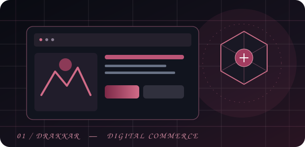

<div align="center">


</div>

<table>
<tr>
<td width="73%" valign="middle">

<h2>Hey, I'm Coco.</h2>

I spend a lot of time turning ideas into things that actually work. Sometimes that's a website, sometimes a game system, sometimes a tool that makes the next project easier.

I like the part where a rough idea slowly becomes something real.

</td>
<td width="27%" align="center" valign="middle">


</td>
</tr>
</table>

<div align="center">

</div>

<h2 align="center">The tools I reach for</h2>

<div align="center">


</div>

<h2 align="center">Things I'm curious to learn</h2>

<div align="center">


</div>

<div align="center">

</div>

<h2 align="center">Selected work</h2>

<table>
<tr>
<td width="48%" valign="middle">
<a href="https://drakkaruruguay.com/"></a>
</td>
<td valign="middle">

<h3>01　Drakkar</h3>

An e-commerce project where I'm shaping the storefront, product experience and the full stack behind it.

<sub>React / Vite / Node.js / Express / PostgreSQL</sub>

<br/><br/>
<a href="https://drakkaruruguay.com/"></a>

</td>
</tr>
<tr>
<td width="48%" valign="middle">
<a href="https://www.roblox.com/games/79524496754754"></a>
</td>
<td valign="middle">

<h3>02　Steal A Crypto</h3>

A Roblox game about building a strange little crypto empire, exploring a neon city and growing your setup.

<sub>Roblox Studio / Luau / Game systems</sub>

<br/><br/>
<a href="https://www.roblox.com/games/79524496754754"></a>

</td>
</tr>
<tr>
<td width="48%" valign="middle">

</td>
<td valign="middle">

<h3>03　ProjectOS</h3>

A project workspace experiment: tasks, planning, connected ideas and an AI assistant that helps keep the work moving.

<sub>Productivity / Automation / AI</sub>

<br/><br/>
<sub>In development</sub>

</td>
</tr>
</table>

<div align="center">

</div>

<table>
<tr>
<td width="70%" valign="middle">

<h2>Somewhere between focus and daydreaming</h2>

A few familiar frames, a quiet playlist, and then back to making things.

</td>
<td width="30%" align="center" valign="middle">


</td>
</tr>
</table>

<div align="center">


<em>One step at a time.</em>

</div>

<details>
<summary><strong>little loop running in the background</strong></summary>

```javascript
while (curious) {
  learn();
  build();
  improve();

  if (theCatIsSleeping) takeABreak();
}
```

</details>

<div align="center">


<sub>still figuring things out. that's the fun part.</sub>

</div>
