<div align="center">


# Hello, Coco! ✦

*Building things, learning as I go, and making the internet a little more interesting.*



</div>

<table>
<tr>
<td width="76%" valign="middle">

I'm interested in **software development, web experiences, game creation and automation**. I learn by building real things, experimenting, and improving them along the way.

Currently spending time on **Drakkar**, **Steal A Crypto** and **ProjectOS**. Each one lets me explore a different side of development, from e-commerce to game systems and creative tools.

</td>
<td width="24%" align="center" valign="middle">

</td>
</tr>
</table>

<div align="center">

</div>

## Things I use

<sub>Tools and technologies I'm actively working with</sub>

<div align="center">


<sub>Web development · Roblox development · Version control</sub>

</div>

<div align="center">

<a href="https://gifdb.com/gif/evangelion-unit-01-roar-md3l2kpsj6eynifu.html">

</a>

<sub>Unit 01 · <a href="https://gifdb.com/gif/evangelion-unit-01-roar-md3l2kpsj6eynifu.html">GIF via GIFDB</a></sub>

</div>

## On my learning list

<div align="center">


<sub>Technologies I want to explore next</sub>

</div>

<div align="center">

</div>

## Things I've been building

<table>
<tr>
<td width="46%" valign="middle">
<a href="https://drakkaruruguay.com/">

</a>
</td>
<td valign="middle">
<strong>Drakkar</strong>

An e-commerce project focused on a clean storefront, thoughtful product pages, and a reliable full-stack foundation.

<sub>React · Vite · Node.js · Express · PostgreSQL</sub>

<a href="https://drakkaruruguay.com/"></a>
</td>
</tr>
<tr>
<td width="46%" valign="middle">
<a href="https://www.roblox.com/games/79524496754754">

</a>
</td>
<td valign="middle">
<strong>Steal A Crypto</strong>

A Roblox experience I'm shaping around a colorful cyber-city, progression, collectible crypto, and playful gameplay systems.

<sub>Roblox Studio · Luau · Game design</sub>

<a href="https://www.roblox.com/games/79524496754754"></a>
</td>
</tr>
<tr>
<td width="46%" valign="middle">

</td>
<td valign="middle">
<strong>ProjectOS</strong>

A personal workspace experiment for planning projects, organizing tasks, and exploring local AI assistance.

<sub>Project planning · JavaScript · Automation · AI</sub>

<sub>Currently in development</sub>
</td>
</tr>
</table>

<table>
<tr>
<td width="76%" valign="middle">

## A little note to self

Keep making small things. Keep asking questions. Don't rush the process.

</td>
<td width="24%" align="center" valign="middle">

</td>
</tr>
</table>

<div align="center">


*One step at a time. Remember to take breaks.*

</div>

A tiny bit of code that belongs somewhere between the projects and the coffee:

```javascript
while (curious) {
  learn();
  build();
  improve();

  if (theCatIsSleeping) takeABreak();
}

// perfectCode is still loading...
```

<div align="center">


<sub>Made slowly, with curiosity and a suspicious amount of cat energy. 🐈</sub>

</div>
