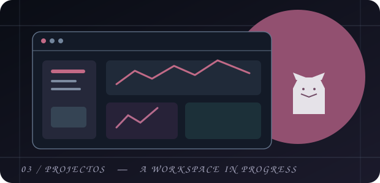

<div align="center">


# Hello, Coco! ✦

*Building things, learning as I go, and making the internet a little more interesting.*


</div>


I'm interested in **software development, web experiences, game creation and automation**. I learn by building real things, experimenting, and improving them along the way.

Currently spending time on:
- **Drakkar** — an e-commerce experience.
- **Steal A Crypto** — a Roblox game with its own world and gameplay systems.
- **ProjectOS** — a workspace for organizing projects and ideas.

<br clear="right"/>

<div align="center">


</div>

## Things I use

A short list of tools I've actually been working with — not a wishlist.

<div align="center">


<sub>Web development · Backend · Databases · Roblox / Luau</sub>

</div>

<div align="center">

</div>

## Things I've been building

<table>
<tr>
<td width="48%" valign="middle">
<a href="https://drakkaruruguay.com/">

</a>
</td>
<td valign="middle">
### Drakkar

An e-commerce project focused on a clean storefront, thoughtful product pages, and a reliable full-stack foundation.

<sub>React · Vite · Node.js · Express · PostgreSQL</sub>

<a href="https://drakkaruruguay.com/"></a>
</td>
</tr>
<tr>
<td width="48%" valign="middle">
<a href="https://www.roblox.com/games/79524496754754">

</a>
</td>
<td valign="middle">
### Steal A Crypto

A Roblox experience I'm shaping around a colorful cyber-city, progression, collectible crypto, and playful gameplay systems.

<sub>Roblox Studio · Luau · Game design</sub>

<a href="https://www.roblox.com/games/79524496754754"></a>
</td>
</tr>
<tr>
<td width="48%" valign="middle">

</td>
<td valign="middle">
### ProjectOS

A personal workspace experiment for planning projects, organizing tasks, and exploring local AI assistance.

<sub>Project planning · JavaScript · Automation · AI</sub>

<sub>Currently in development</sub>
</td>
</tr>
</table>

<div align="center">


</div>


## A little note to self

Keep making small things. Keep asking questions. Don't rush the process.

<br clear="right"/>

<div align="center">


*One step at a time. Remember to take breaks.*

</div>

A tiny bit of code that belongs somewhere between the projects and the coffee:

```javascript
while (curious) {
  learn();
  build();
  improve();

  if (theCatIsSleeping) takeABreak();
}

// perfectCode is still loading...
```

<div align="center">


<sub>Made slowly, with curiosity and a suspicious amount of cat energy. 🐈</sub>

</div>
