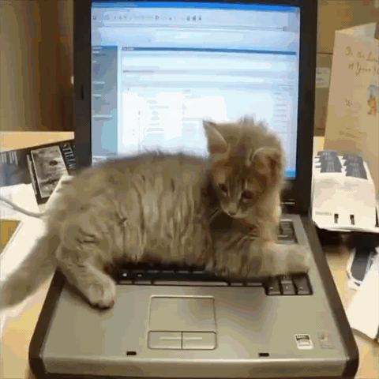
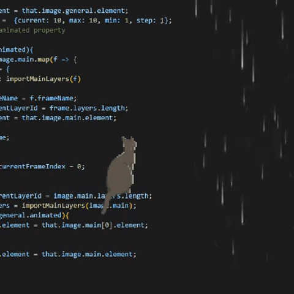
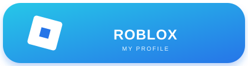
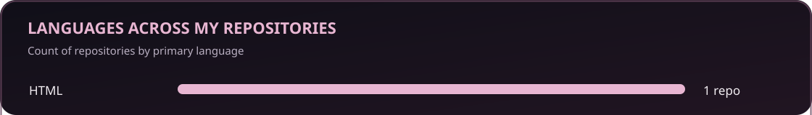
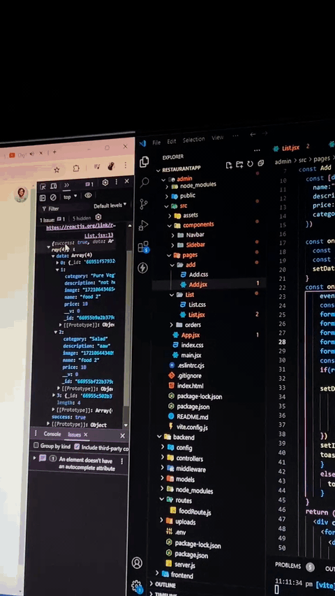
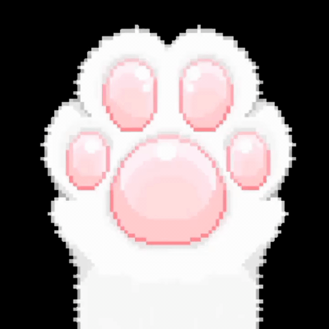
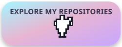

<em>developer in progress ✦ curious mind ✦ Uruguay 🇺🇾</em>

&nbsp;&nbsp;

  

---

## A bit about me

<table>
<tr>
<td width="68%" valign="middle">

I'm usually somewhere between having an idea and figuring out how to build it.

I enjoy creating things that have their own atmosphere — from an online store to a game world, or a tool that makes everyday work feel less chaotic. I move between code, design and experimentation, and I'm still exploring where that takes me.

Right now, I'm learning by making projects, breaking things, fixing them and trying again.

</td>
<td width="32%" align="center" valign="middle">

</td>
</tr>
</table>

  
  &nbsp;&nbsp;&nbsp;
  

---

## What I work with

**Languages**

**Frameworks & runtime**

**Tools & platforms**

  

---

<em>✦ Two different playgrounds. One endless process of building, experimenting and improving. ✦</em>

  

<table>
  <tr>
    <td width="50%" valign="top" align="center">
      
        
      
      
<em>An e-commerce experience focused on product discovery, visual presentation and the engineering behind a real storefront.</em>

      
        
      
    </td>
    <td width="50%" valign="top" align="center">
      
        
      
      
<em>A neon city where players build bases, collect crypto, upgrade their setup and progress through a world of custom game systems.</em>

      
        
      
    </td>
  </tr>
</table>

---

&nbsp;&nbsp;&nbsp;

---

## A little arcade break

<em><strong>One more round. One more commit.</strong></em>

---

## GitHub activity

---

## Outside the editor

A soundtrack on repeat, a scene that stays in my head, a late-night idea ✦ and then back to making things.

&nbsp;&nbsp;&nbsp;

<table>
  <tr>
    <td width="50%" align="center"></td>
    <td width="50%" align="center"></td>
  </tr>
</table>

<em>Take a breath. Then one more commit.</em>

 

