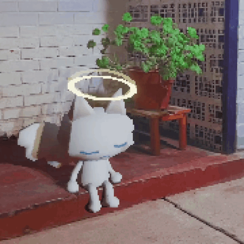
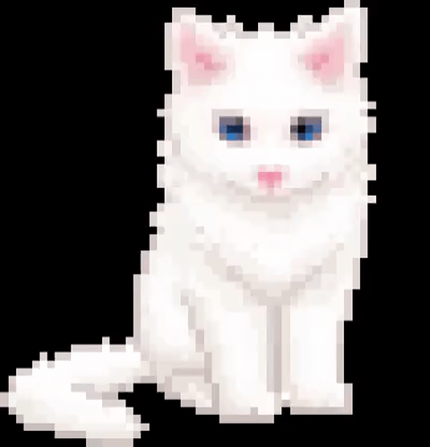
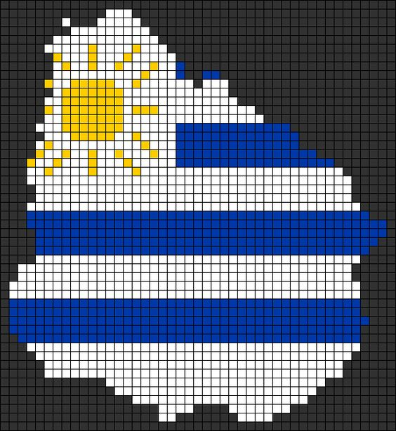
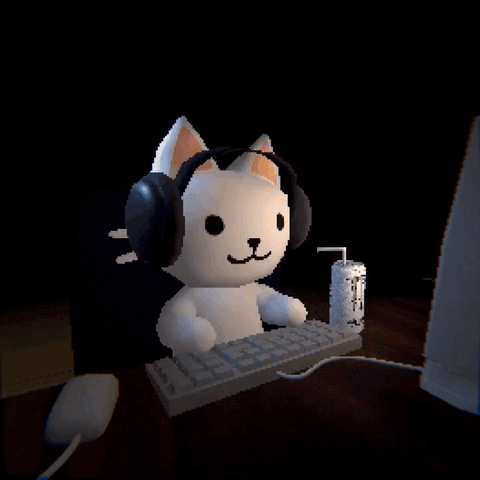
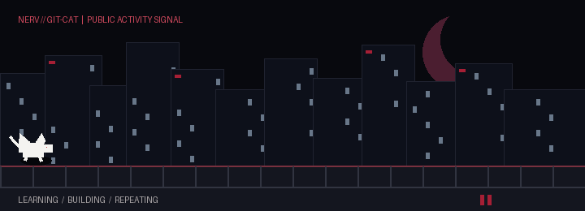
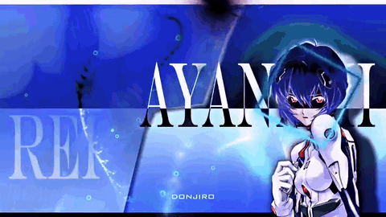
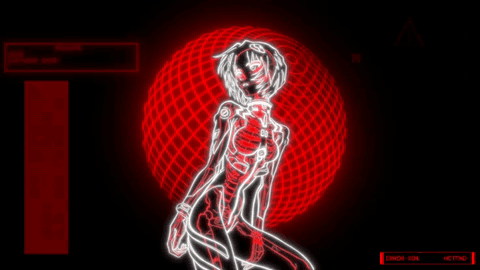
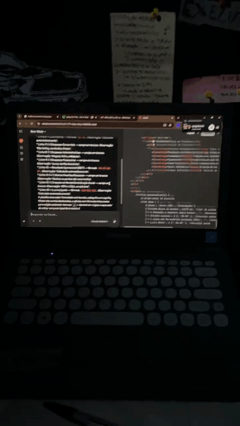
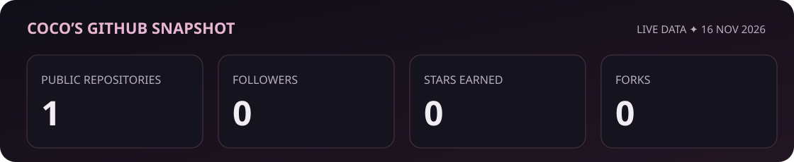
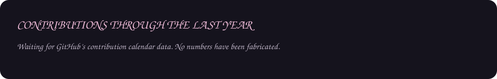

<em>developer in progress · curious mind · Uruguay 🇺🇾</em>

<a href="https://www.drakkaruruguay.com/">Drakkar</a> &nbsp;·&nbsp;
<a href="https://www.roblox.com/es/games/105760353161876/Steal-A-Crypto#!/store">Steal A Crypto</a> &nbsp;·&nbsp;
<a href="#projectos">ProjectOS</a>

  

&nbsp;&nbsp;

&nbsp;&nbsp;

---

## A bit about me

<table>
<tr>
<td width="68%" valign="middle">

I'm usually somewhere between having an idea and figuring out how to build it.

I enjoy creating things that have their own atmosphere — from an online store to a game world, or a tool that makes everyday work feel less chaotic. I move between code, design and experimentation, and I'm still exploring where that takes me.

Right now, I'm learning by making projects, breaking things, fixing them and trying again.

</td>
<td width="32%" align="center" valign="middle">

</td>
</tr>
</table>

  
  &nbsp;&nbsp;&nbsp;
  
  &nbsp;&nbsp;&nbsp;
  

---

## What I work with

**Languages**

**Frameworks & runtime**

**Tools & platforms**

<table>
<tr>
<td width="65%" valign="middle">

</td>
<td width="35%" align="center" valign="middle">

</td>
</tr>
</table>

---

## Things I'm building

<em>Different ideas, different challenges. All works in progress.</em>

<table>
  <tr>
    <td width="39%" valign="middle">
      
    </td>
    <td width="45%" valign="middle">
      <h3>Drakkar</h3>
      
An e-commerce experience focused on product presentation, discovery and the systems behind a real storefront.

      REACT · VITE · NODE.JS · EXPRESS · POSTGRESQL
        
      <a href="https://www.drakkaruruguay.com/">Visit the store ↗</a>
    </td>
    <td width="16%" align="center" valign="middle">
      
    </td>
  </tr>
  <tr>
    <td width="39%" valign="middle">
      
    </td>
    <td width="45%" valign="middle">
      <h3>Steal A Crypto</h3>
      
A Roblox game set in a neon city. Build your base, collect crypto, upgrade your setup and explore a world built around its own little systems.

      ROBLOX STUDIO · LUAU · GAME SYSTEMS
        
      <a href="https://www.roblox.com/es/games/105760353161876/Steal-A-Crypto#!/store">Open the game ↗</a>
    </td>
    <td width="16%" align="center" valign="middle">
      
    </td>
  </tr>
  <tr>
    <td width="39%" valign="middle">
      
    </td>
    <td width="45%" valign="middle">
      <h3 id="projectos">ProjectOS</h3>
      
A personal productivity workspace built around tasks, connected ideas, planning flows and an AI assistant that helps turn plans into action.

      PRODUCTIVITY · AUTOMATION · AI
    </td>
    <td width="16%" align="center" valign="middle">
      
    </td>
  </tr>
</table>

  

---

## GitHub activity

---

## Outside the editor

A soundtrack on repeat, a scene that stays in my head, a late-night idea — and then back to making things.

&nbsp;&nbsp;&nbsp;

<em>Take a breath. Then one more commit.</em>

 

made with curiosity · Coco / Uruguay 🇺🇾

