<div align="center">




</div>

<table>
<tr>
<td width="66%" valign="top">

<h2>Hey. I'm Coco.</h2>

I'm usually somewhere between having an idea and trying to make it real.

I like building things that feel considered: a storefront with its own character, a game world with little details to discover, or a tool that makes a messy process easier.

I don't really want to stay in one box. I want to understand how things work, experiment, and get a little better with every version.

</td>
<td width="34%" align="center" valign="middle">


<br/>


<sub>quiet mind · noisy ideas</sub>

</td>
</tr>
</table>

<div align="center">

</div>

<h2 align="center">The workbench</h2>

<div align="center">

**Languages**


**Frameworks & runtime**


**Tools & platforms**


</div>

<table>
<tr>
<td width="50%" valign="top">

**What pulls me in**

Interfaces with personality. Systems that click together. Game mechanics that make you want to try one more time. The tiny details that make a project feel alive.

</td>
<td width="50%" valign="top">

**What I'm chasing**

A stronger foundation in programming, better ways to structure ideas, and the ability to take a project from a rough sketch all the way to something people can use.

</td>
</tr>
</table>

<div align="center">


</div>

<div align="center">

</div>

<h2 align="center">Selected work <sub> / things taking shape</sub></h2>

<p align="center"><sub>Not a collection of tutorials. Just a few ideas I'm putting real time into.</sub></p>

<table>
<tr>
<td width="52%" valign="middle">
<a href="https://drakkaruruguay.com/"></a>
</td>
<td valign="middle">

<h3>01 — Drakkar</h3>

**A storefront with a point of view.**

An e-commerce project focused on the full experience: product discovery, presentation, and the systems working behind the scenes.

<sub>REACT　·　VITE　·　NODE.JS　·　EXPRESS　·　POSTGRESQL</sub>

<br/>

<a href="https://drakkaruruguay.com/"></a>

</td>
</tr>
<tr>
<td width="52%" valign="middle">
<a href="https://www.roblox.com/games/79524496754754"></a>
</td>
<td valign="middle">

<h3>02 — Steal A Crypto</h3>

**A city built around one strange idea.**

A Roblox game about building a crypto empire, exploring a neon city, upgrading your base and discovering how its systems fit together.

<sub>ROBLOX STUDIO　·　LUAU　·　GAME SYSTEMS</sub>

<br/>

<a href="https://www.roblox.com/games/79524496754754"></a>

</td>
</tr>
<tr>
<td width="52%" valign="middle">

</td>
<td valign="middle">

<h3>03 — ProjectOS</h3>

**A workspace for getting ideas out of your head.**

An experiment in project management: tasks, connected ideas, planning flows and an AI assistant designed to help move work forward.

<sub>PRODUCTIVITY　·　AUTOMATION　·　AI</sub>

<br/>

<sub>IN DEVELOPMENT</sub>

</td>
</tr>
</table>

<div align="center">

</div>

<h2 align="center">A little arcade break</h2>

<div align="center">


<sub>one more round · one more commit</sub>

</div>

<div align="center">

</div>

<h2 align="center">GitHub activity</h2>

<div align="center">


<picture>
  <source media="(prefers-color-scheme: dark)" srcset="https://raw.githubusercontent.com/jattu8602/jattu8602/output/pacman-contribution-graph-dark.svg">
  <source media="(prefers-color-scheme: light)" srcset="https://raw.githubusercontent.com/jattu8602/jattu8602/output/pacman-contribution-graph.svg">
  
</picture>


</div>

<div align="center">

</div>

<table>
<tr>
<td width="68%" valign="middle">

<h2>Things that keep me inspired</h2>

A late-night idea, a soundtrack on repeat, a scene that stays in my head longer than expected. Then I go back to the editor and try to make something of it.

</td>
<td width="32%" align="center" valign="middle">


</td>
</tr>
</table>

<div align="center">


<em>Take a breath. Then one more commit.</em>

</div>

<details>
<summary><strong>a tiny process running somewhere</strong></summary>

```javascript
const loop = [
  "notice something",
  "get curious",
  "make a prototype",
  "break it",
  "understand why",
  "make it better"
];

for (const step of loop) {
  keepGoing(step);
}
```

</details>

<div align="center">


<sub>made slowly, with curiosity — Coco / UY</sub>

</div>
