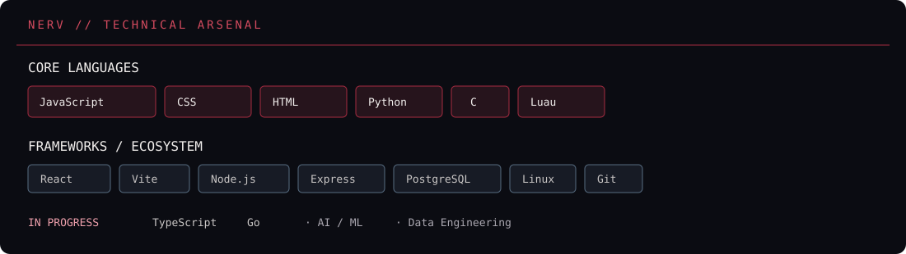
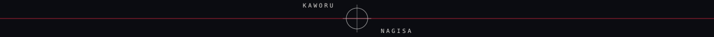

<div align="center">


### JOACOXZ712 · DEVELOPER / BUILDER

**Building useful things, learning constantly, occasionally debugging at 03:00.**

`JavaScript` · `CSS` · `React` · `Node.js` · `Python` · `C` · `Luau`


</div>

## 01 / PERSONNEL FILE

I'm a developer interested in software engineering, creative tooling, game development and applied AI.

- Building web applications and interactive experiences.
- Exploring automation, backend development and AI-assisted workflows.
- Learning by shipping projects, breaking things and fixing them.
- Current focus: stronger fundamentals, cleaner architecture and better products.

## 02 / TECHNICAL ARSENAL

<div align="center">



</div>

<table>
<tr><td width="50%" valign="top">

**LANGUAGES & WEB**

- JavaScript · HTML · CSS
- Python · C
- Luau / Roblox scripting
- TypeScript — currently learning

</td><td width="50%" valign="top">

**FRAMEWORKS & TOOLS**

- React · Vite · Node.js · Express
- PostgreSQL · Drizzle ORM · Neon
- Git · GitHub · Linux
- Vercel · Render · Roblox Studio

</td></tr>
</table>

**NEXT OBJECTIVES**

`Go` · `Advanced TypeScript` · `AI / Machine Learning` · `Data Engineering`

## 03 / SELECTED PROJECTS

| PROJECT | DEVELOPMENT FOCUS |
|:--|:--|
| **Drakkar** | Full-stack e-commerce · React · PostgreSQL |
| **Steal A Crypto** | Roblox game development · Luau · gameplay systems · [Roblox project](https://www.roblox.com/games/79524496754754) |
| **ProjectOS** | Project management · local AI · automation |

## 04 / PERSONNEL ARCHIVE

<div align="center">

<table>
<tr>
<td width="50%" align="center">

**FIRST CHILD // REI AYANAMI**


</td>
<td width="50%" align="center">

**FIFTH CHILD // KAWORU NAGISA**


</td>
</tr>
</table>

<sub>EVANGELION ARCHIVE // External animated media hosted by Tenor.</sub>

</div>

## 05 / LIVE DEVELOPMENT CONSOLE

Explore the interactive dashboard with activity history, language distribution and repository data:

<div align="center">

[OPEN NERV DEVELOPMENT CONSOLE](https://joacoxz712.github.io/Joacoxz712/)

</div>

## 06 / DEVELOPMENT LOG

<div align="center">


<sub>GIT-CAT // White pixel cat exploring a night city. Animation generated by GitHub Actions.</sub>

</div>

## 07 / DEBUGGING PHILOSOPHY

```javascript
if (codeWorking) {
    while (codeQuality < perfectCode) {
        codeQuality++;
    }
}

// ERROR: perfectCode not found.
// Developer is still learning. 🐈
```

```python
while True:
    learn()
    build()
    improve()

    if cat_is_sleeping:
        take_break()
```

<div align="center">



<sub>「God's in his heaven. All's right with the world.」</sub>

**SYSTEM STATUS:** `LEARNING` · `BUILDING` · `REPEATING`


</div>