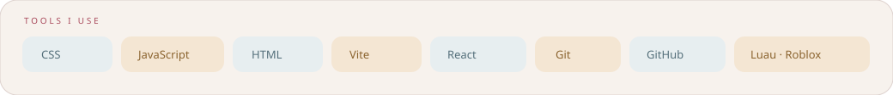
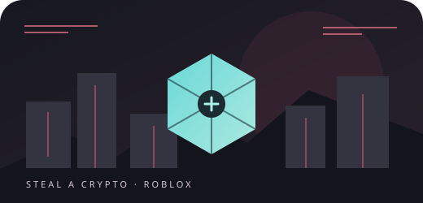

<div align="center">


<table>
<tr>
<td align="center"><a href="https://github.com/Joacoxz712"></a></td>
<td align="center"></td>
<td align="center"></td>
</tr>
</table>

</div>

<table>
<tr>
<td width="72%" valign="middle">

<h2> A little about me </h2>

I'm interested in **software development, creative web experiences, game creation and automation**.

I like learning by making real projects, trying ideas, breaking things, fixing them and slowly turning rough concepts into something I can be proud of.

Right now, most of my energy goes into **Drakkar**, **Steal A Crypto** and **ProjectOS**.

</td>
<td width="28%" align="center" valign="middle">


<sub>quiet focus mode</sub>

</td>
</tr>
</table>

<div align="center">

</div>

<h2 align="center">My current toolkit</h2>

<div align="center">



</div>

<h2 align="center">Things I want to learn next</h2>

<div align="center">


</div>

<div align="center">

</div>

<h2 align="center">Selected projects</h2>

<table>
<tr>
<td width="46%" valign="middle">
<a href="https://drakkaruruguay.com/"></a>
</td>
<td valign="middle">
<h3>01 / Drakkar</h3>
An e-commerce project focused on a clean storefront, thoughtful product pages and a full-stack foundation.

<sub>React · Vite · Node.js · Express · PostgreSQL</sub>

<br/>
<a href="https://drakkaruruguay.com/"></a>
</td>
</tr>
<tr>
<td width="46%" valign="middle">
<a href="https://www.roblox.com/games/79524496754754"></a>
</td>
<td valign="middle">
<h3>02 / Steal A Crypto</h3>
A Roblox game in development, built around a colorful cyber-city, progression, collectible crypto and playful systems.

<sub>Roblox Studio · Luau · Game design</sub>

<br/>
<a href="https://www.roblox.com/games/79524496754754"></a>
</td>
</tr>
<tr>
<td width="46%" valign="middle">

</td>
<td valign="middle">
<h3>03 / ProjectOS</h3>
A personal workspace experiment for planning projects, organizing tasks and exploring local AI assistance.

<sub>Project planning · Automation · AI</sub>

<br/>
<sub>In development</sub>
</td>
</tr>
</table>

<div align="center">

</div>

<table>
<tr>
<td width="72%" valign="middle">

<h2>A few things that keep me inspired</h2>

A little music, a few familiar frames, a quiet workspace and something new to build.

</td>
<td width="28%" align="center" valign="middle">


</td>
</tr>
</table>

<div align="center">


<sub><a href="https://gifdb.com/gif/evangelion-3-0-kaworu-nagisa-u6ib2cxr7srtyfkt.html">Kaworu · GIF source</a></sub>

</div>

<div align="center">


<em>One step at a time. Remember to take breaks.</em>

</div>

<details>
<summary><strong>A tiny piece of my brain</strong></summary>

```javascript
while (curious) {
  learn();
  build();
  improve();

  if (theCatIsSleeping) takeABreak();
}

// perfectCode is still loading...
```

</details>

<div align="center">


<sub>Made with curiosity, a little chaos and a suspicious amount of cat energy.</sub>

</div>
