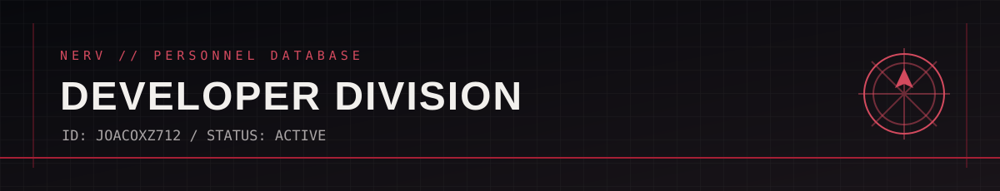

### Hi, I'm Joaco ✦

*I like building things, learning how they work, and making them a little better every day.*

 

## A little about me

I’m interested in **software development, game creation, automation and AI**. I enjoy learning by making real projects — from web apps to Roblox experiences — and improving them as I go.

- Currently building: **Drakkar**, **Steal A Crypto** and **ProjectOS**
- Learning path: stronger programming foundations, backend, TypeScript and AI
- I like clean interfaces, thoughtful details and a little bit of personality. 🐈

## Things I work with

**CORE** 

**ALSO EXPLORING** 

Technologies grow as I learn and build — this is a snapshot, not a checklist.

## Projects

<table>
<tr>
<td width="50%" valign="top">

### Drakkar
A full-stack e-commerce project focused on product experience, storefront design and reliable backend foundations.

React · Node.js · PostgreSQL

[View repository](https://github.com/Drakkar-uy/drakkar)

</td>
<td width="50%" valign="top">

### Steal A Crypto
A Roblox game project about building a playful world, gameplay systems, progression and memorable moments.

Roblox Studio · Luau

[Open on Roblox](https://www.roblox.com/games/79524496754754)

</td>
</tr>
<tr>
<td width="50%" valign="top">

### ProjectOS
A personal project workspace exploring task organization, project planning and local AI assistance.

JavaScript · AI · Automation

</td>
<td width="50%" valign="top">

### More experiments
Small tools, prototypes and ideas are part of the process. More projects will appear here as they become ready.

Learning · Building · Iterating

</td>
</tr>
</table>

## A small corner of my world

<table>
<tr>
<td align="center" width="50%">

**Rei · quiet focus**

</td>
<td align="center" width="50%">

**Kaworu · gentle chaos**

</td>
</tr>
</table>

*One step at a time. Remember to take breaks.*

## Currently

~~~javascript
while (curious) {
  learn();
  build();
  improve();

  if (theCatIsSleeping) takeABreak();
}
~~~

[**A little more detail → interactive GitHub activity & cat companion**](https://joacoxz712.github.io/Joacoxz712/)

Made with curiosity, coffee, and a suspicious amount of cat energy.

